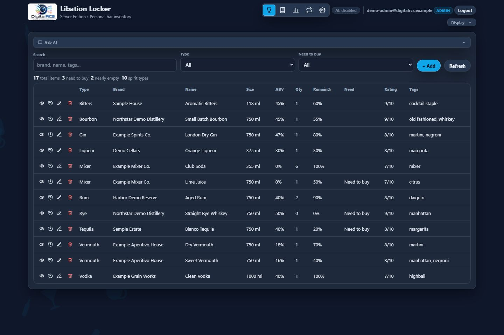
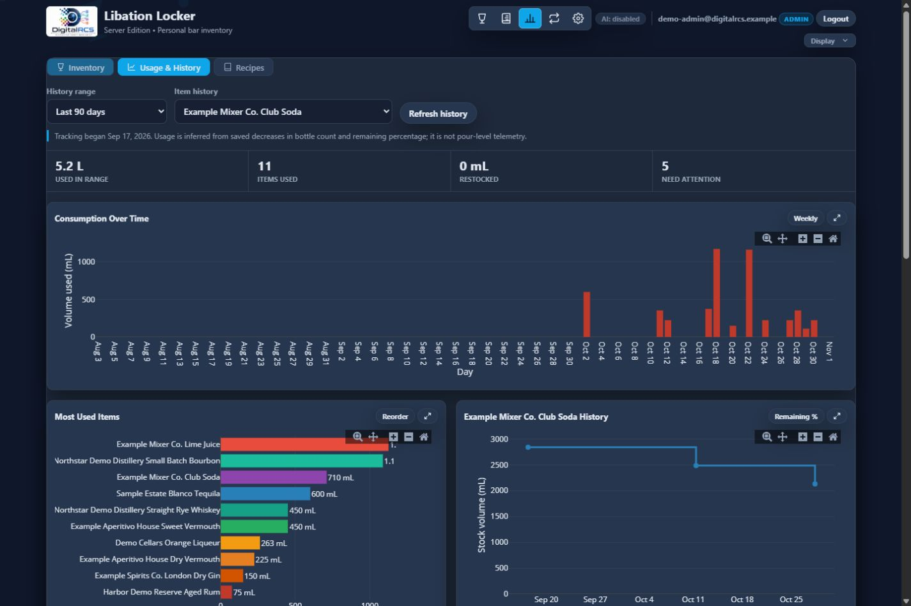

<p align="center">
  
</p>

# Libation Locker 2 - Server Edition

[](https://github.com/digitalrcs/LibationLocker2/actions/workflows/build.yml)
[](LICENSE)
[](https://dotnet.microsoft.com/download/dotnet/8.0)

Libation Locker is a self-hosted personal bar inventory and recipe application built with ASP.NET Core Razor Pages, .NET 8, and Microsoft SQL Server. Track bottle quantities, remaining amounts, ratings, shopping needs, recipes, and inventory history from a responsive browser interface. Optional LM Studio integration can answer inventory-aware questions without requiring a cloud AI provider.

> Built and maintained by **DigitalRCS**.

## Server Edition vs. ESP32 Edition

This repository contains the **server edition**. It is separate from the DigitalRCS ESP32 firmware version already published on GitHub.

| Area | Libation Locker 2 Server Edition | Libation Locker ESP32 Edition |
|---|---|---|
| Host | .NET 8 on a PC, server, container-capable host, or IIS | ESP32-S3 hardware flashed with firmware |
| Data | Microsoft SQL Server LocalDB, Express, Developer, Standard, or Enterprise | Device-local embedded storage |
| Access | Multi-user browser application with database-backed accounts and roles | Standalone appliance-style browser interface hosted by the device |
| Deployment | `dotnet publish`, Kestrel, IIS, or reverse proxy | Firmware build and flash workflow |
| Scale | Centralized inventory, recipes, history, analytics, backups, and server resources | Portable, low-power, self-contained hardware deployment |
| Best fit | Shared household/team access and long-term history | Dedicated physical bar controller or embedded installation |

The editions share the Libation Locker concept and import/export workflow, but they are different applications with different setup and deployment requirements. See [Server Edition vs. ESP32 Edition](docs/esp32-comparison.md).

## Highlights

- Inventory management with types, brands, sizes, ABV, quantity, remaining percentage, ratings, tags, and notes.
- Recipe library with Markdown content, categories, ratings, and tags.
- Import, export, and shopping-list workflows.
- Append-only item history with usage trends, restock detection, reorder estimates, and per-item timelines.
- Optional LM Studio or OpenAI-compatible AI with model discovery, streaming, configurable timeouts, and availability status.
- Cookie authentication, database-backed users, roles, and a removable first-run bootstrap administrator.
- Multiple themes and responsive desktop/mobile layouts.
- SQL Server LocalDB, Express, Developer, Standard, and Enterprise support.

## Screenshots

### Inventory



### Usage And History



## Quick Start

### Requirements

- Windows, Linux, or macOS capable of running the [.NET 8 SDK](https://dotnet.microsoft.com/download/dotnet/8.0).
- Microsoft SQL Server 2016 or newer. For a lightweight Windows setup, use SQL Server LocalDB or Express.
- `sqlcmd` for the included setup scripts.

> SQLite and SQL Server Compact are not supported. Libation Locker uses SQL Server stored procedures, triggers, `OPENJSON`, and SQL Server-specific views.

### 1. Create The Database

From PowerShell in the repository root:

```powershell
.\scripts\Initialize-Database.ps1 -SeedDemoData
```

This creates `LibationLocker` in `(localdb)\MSSQLLocalDB` and loads optional fictional demo data. Omit `-SeedDemoData` for an empty installation.

For SQL Server Express:

```powershell
.\scripts\Initialize-Database.ps1 -ServerInstance ".\SQLEXPRESS"
```

For a remote SQL Server using Windows authentication:

```powershell
.\scripts\Initialize-Database.ps1 -ServerInstance "sql.example.test"
```

See [Database Setup](docs/database.md) for SQL authentication and permission guidance.

### 2. Configure The First Administrator

The repository contains no default password. Set temporary bootstrap credentials in the current shell:

```powershell
$env:LibationLocker__BootstrapAdmin__Enabled = "true"
$env:LibationLocker__BootstrapAdmin__Email = "admin@example.test"
$env:LibationLocker__BootstrapAdmin__Password = "use-a-long-unique-password"
```

### 3. Run The Application

```powershell
dotnet run --project .\src\LibationLocker.Web\LibationLocker.Web.csproj
```

Open `http://localhost:5058`, sign in with the bootstrap account, create a permanent database-backed administrator under **Admin > Users**, disable bootstrap login, and remove the bootstrap environment variables.

## Configuration

The checked-in configuration uses LocalDB and contains no credentials. Override settings with environment variables or a private, ignored `appsettings.Production.json` file when running in the Production environment.

```powershell
$env:ConnectionStrings__LibationLocker = "Server=.\SQLEXPRESS;Database=LibationLocker;Trusted_Connection=True;TrustServerCertificate=True;"
```

Read [Configuration](docs/configuration.md), [LM Studio](docs/lm-studio.md), and [Security](docs/security.md) before exposing the application beyond a trusted network.

## Documentation

- [Installation](docs/installation.md)
- [Database Setup](docs/database.md)
- [Demo Data](docs/demo-data.md)
- [Server Edition vs. ESP32 Edition](docs/esp32-comparison.md)
- [Configuration](docs/configuration.md)
- [LM Studio Integration](docs/lm-studio.md)
- [IIS Deployment](docs/deployment-iis.md)
- [Security](docs/security.md)
- [Troubleshooting](docs/troubleshooting.md)
- [Publishing to GitHub](docs/publishing-github.md)
- [GitHub Wiki Sources](wiki/Home.md)

## Build And Package

```powershell
dotnet build .\src\LibationLocker.Web\LibationLocker.Web.csproj -c Release
.\scripts\Publish.ps1
.\scripts\New-GitHubPackage.ps1 -Version "2.0.0"
```

Publish output is written under `artifacts/publish/LibationLocker`. The GitHub source archive is written under `artifacts/` and excludes production configuration, exports, build output, logs, and local images.

## Contributing And Support

Read [CONTRIBUTING.md](CONTRIBUTING.md) before submitting a change. Report security concerns using the private process in [SECURITY.md](SECURITY.md), not a public issue.

## License

Libation Locker 2 Server Edition is open-source software licensed under the [MIT License](LICENSE).

Copyright (c) 2026 **Daniel Roberts and DigitalRCS**. The MIT License requires the copyright and permission notice to remain with copies or substantial portions of the software.
